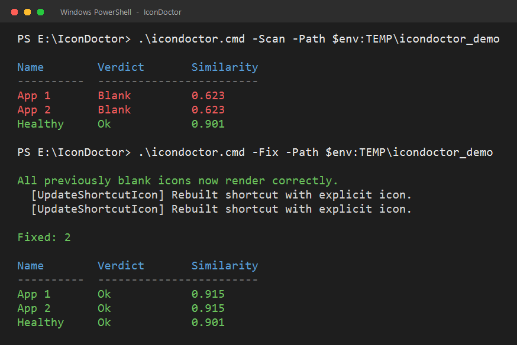

# IconDoctor

**English** | [简体中文](README.md)

> Every tutorial tells you to clear the icon cache. What do you do when that doesn't work?

[](https://github.com/EllarDomme/IconDoctor/actions/workflows/ci.yml)




---

## Why this exists

Blank desktop icons are one of Windows' classic "unsolvable" problems. Every guide gives the same four steps:

1. Kill `explorer.exe`
2. Delete `iconcache_*.db`
3. Restart `explorer.exe`
4. Run `ie4uinit.exe -show`

That fixes the **cache layer** — maybe 70–80% of cases. The rest of the time you are told to reinstall Windows.

But "blank icon" has **at least seven** possible causes, and cache clearing only covers one of them:

| Layer | Question | How IconDoctor decides |
|---|---|---|
| **L1 · Icon source** | Does the program still carry an icon? | `ExtractIconEx` straight from the PE, bypassing the cache |
| **L2 · Shortcut** | Is the `.lnk` itself intact? | Target / arguments / working directory resolvable |
| **L3 · Icon cache** | Is the cache corrupt or full? | Database sizes, `Max Cached Icons` |
| **L4 · Shell handler** | Is the `.lnk` IconHandler still registered? | `HKCR\lnkfile\shellex\IconHandler` → `windows.storage.dll` |
| **L5 · Folder object** | **Is this folder poisoning icon resolution?** | Probe shortcut inside the folder, cross-checked in `%TEMP%` |
| **L6 · Folder ACL** | Any unusual permission entries? | Deny rules, orphan SIDs (`S-1-4-*`) |
| **L7 · Integrity label** | **Has the folder been dropped to a low integrity level?** | Mandatory label in the SACL (Low/Medium/High) |

**L5 is the layer almost no tool covers** — and it is a real failure mode that cache clearing can never fix. IconDoctor started as one of those cases; see [docs/case-study.en.md](docs/case-study.en.md).

## The core idea: icon fingerprinting

To claim "fixed", a tool has to know what a blank icon looks like — objectively.

1. **Reference** — extract the icon straight from the target executable with `ExtractIconEx`. This is what the icon *should* look like, cache bypassed.
2. **Actual** — read the icon the shell would draw with `SHGetFileInfo`, the same path Explorer uses.
3. **Fingerprint** — downsample both to a 16×16 RGB grid and compute mean absolute difference, giving a 0–1 similarity score.
4. **Blank test** — white ratio ≥ 45% **and** mean saturation ≤ 0.18.

Two conditions, both required. A white-ratio test alone misfires badly: real brand icons with white backgrounds (Baidu Netdisk, WeChat, many others) score 0.93–0.98 similarity, while a genuinely blank icon sits at 0.62.

That is why `-Fix` can re-scan afterwards and report *"all previously blank icons now render correctly"* instead of asking you to squint at your desktop.

## Install

```powershell
git clone https://github.com/EllarDomme/IconDoctor.git
cd IconDoctor
Import-Module .\IconDoctor.psd1
```

No module import needed for the CLI:

```powershell
.\bin\IconDoctor.ps1 -Scan
```

**No command line at all**: double-click `icondoctor.cmd`. It runs the full diagnosis through a process-local execution-policy bypass and waits with the results on screen. (Windows blocks `.ps1` by default — that wrapper exists exactly for this.)

## Usage

### Scan (read-only)

```powershell
Get-IconReport | Format-Table Name, Verdict, Similarity
```

Each shortcut gets a `Verdict`: `Ok` / `Blank` / `TargetMissing` / `NoIconSource` / `Skipped`.

### Diagnose

```powershell
Invoke-IconDiagnosis | Select-Object -ExpandProperty Layers |
    Format-Table Layer, Name, Status, Detail -AutoSize -Wrap
```

Every layer reports `Pass / Warn / Fail / Skip` with its evidence, and the first failing layer is returned as the root cause.

### Repair

```powershell
Invoke-IconRepair -WhatIf                # dry run, changes nothing
Invoke-IconRepair                        # safe operations only
Invoke-IconRepair -RestartExplorer       # allow the icon cache reset
Invoke-IconRepair -RestartExplorer -RebuildFolderObject -Force   # allow folder rebuild
```

## What gets fixed automatically

| Layer | Detected | Auto-fixed | Notes |
|---|---|---|---|
| L1 · Icon source | ✅ | ❌ | Nothing to fix; the program has no icon |
| L2 · Shortcut | ✅ | ✅ | Rebuilt, arguments and working directory preserved |
| L3 · Icon cache | ✅ | ✅ | Needs `-RestartExplorer` |
| L4 · Shell handler | ✅ | ❌ | Re-registration needs admin; detection only |
| L5 · Folder object | ✅ | ✅ | Needs `-Force`; moves files, with rollback |
| L6 · Folder ACL | ✅ | ❌ | Reports the evidence and a recommendation |

## Safety

- `-Scan` and `-Diagnose` are **strictly read-only** — no registry writes, no file changes.
- `-Fix` performs **reversible** operations only, and backs up before each change to `%TEMP%\IconDoctor\backup_<timestamp>\`.
- Restarting Explorer requires `-RestartExplorer` (it closes every open folder window).
- Rebuilding a folder object requires `-RebuildFolderObject -Force` and rolls back entirely if any file cannot be moved.
- Windows 10 and later only.

## Limitations

- Programs without an icon resource (L1) cannot be fixed by anything — the tool only reports them.
- `.url` files are not scanned (different handler).
- Blank detection is a **heuristic**: a rare icon that is genuinely near-white and desaturated could be misreported. `-Detailed` exposes the raw numbers.
- L4 auto-repair (re-registering ShellExperienceHost) needs elevation and is not implemented yet.

## Development

```powershell
Invoke-Pester -Path ./tests
Invoke-ScriptAnalyzer -Path . -Recurse -Settings ./PSScriptAnalyzerSettings.psd1
```

CI runs the suite on Windows with PowerShell 5.1 and 7, and enforces **zero** analyzer warnings.

## Contributing

Issues are welcome — especially **your blank icon case**. The most useful attachment is:

```powershell
.\bin\IconDoctor.ps1 -Diagnose -Json > diagnosis.json
```

The seven probe results in that file usually identify the failure mode immediately.

## License

[MIT](LICENSE)
